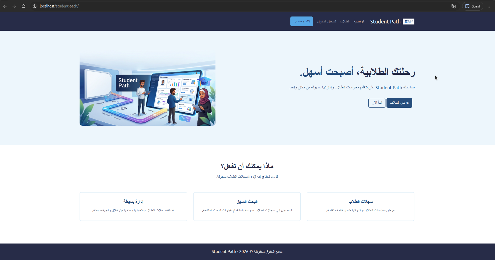
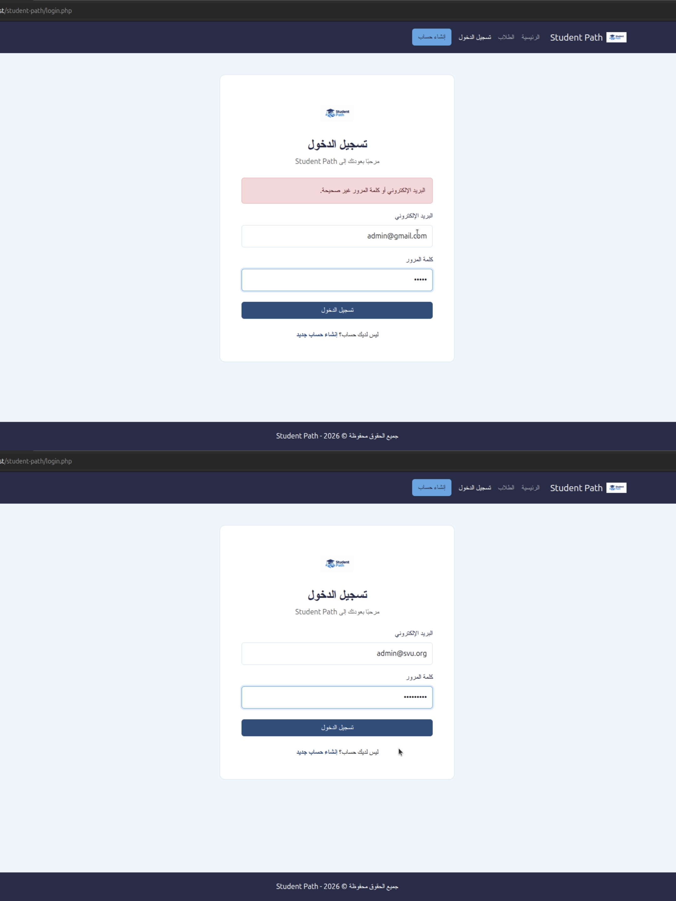
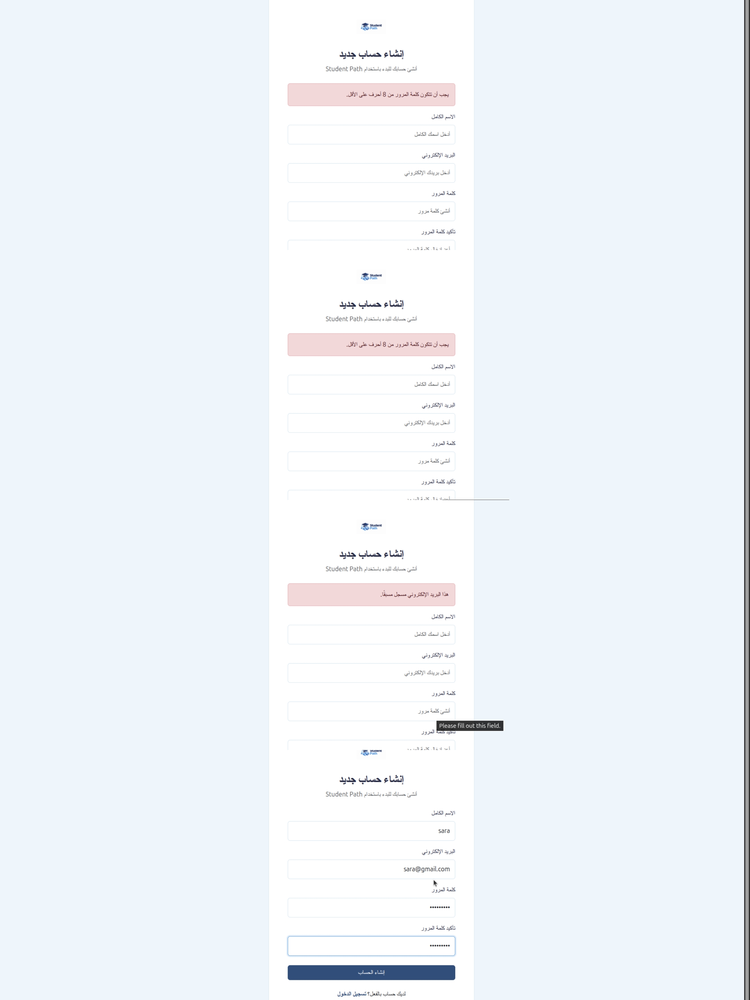
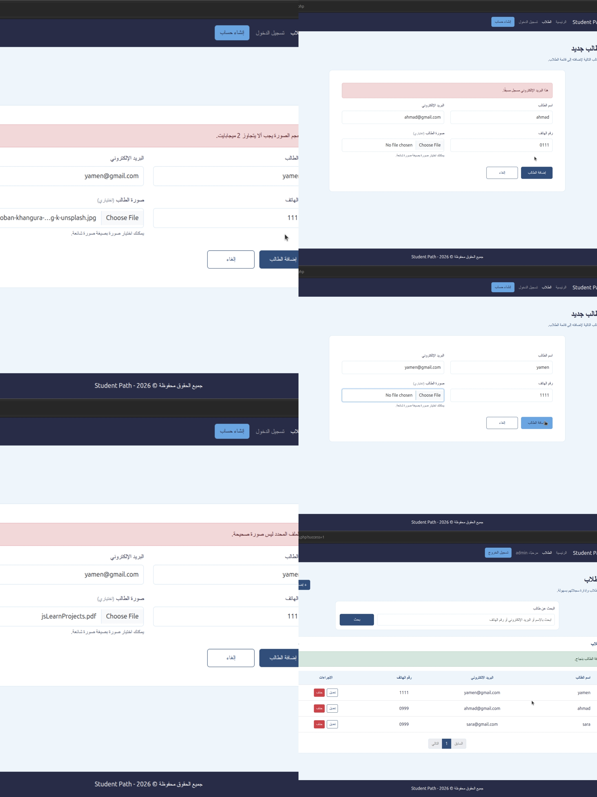
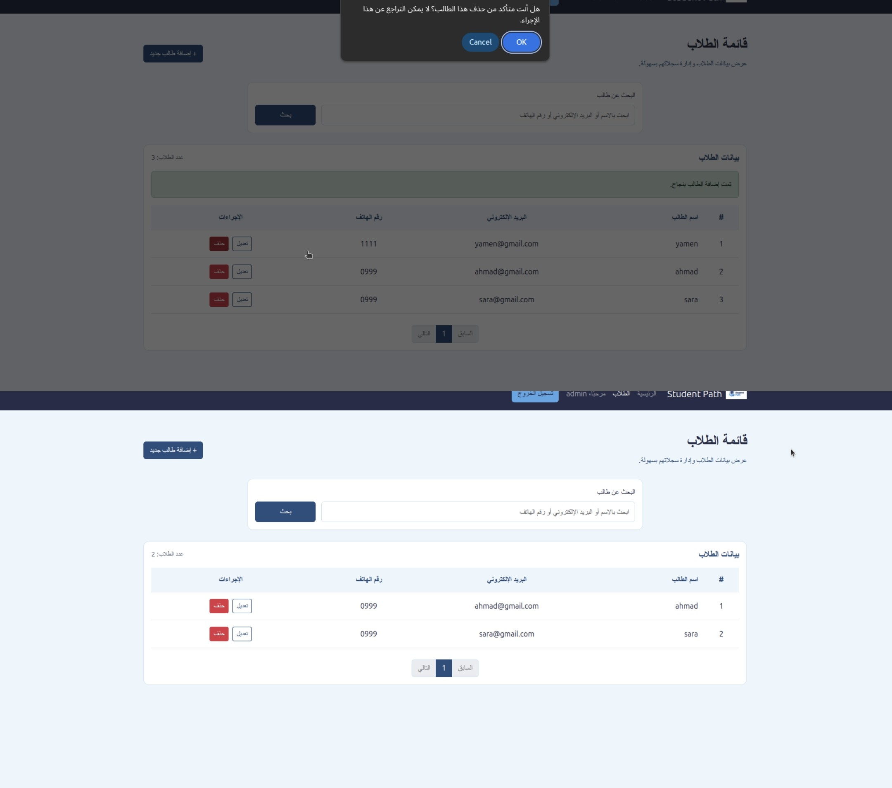

تقرير Student Path :

1) إعداد قاعدة البيانات و تهيئة المشروع:
يعتمد المشروع على قاعدة بيانات MySQL من اجل تخزين بيانات المستخدمين و الطلاب ، تم استخدام PHPMyAdmin من اجل بناء و ادارة فاعدة البيانات
في البداية قمنا بانشاء قاعدة بيانات باسم student_path_db ثم قمنا بانشاء جدولين داخلها الاول students و هو جدول يحتوي على معلومات الطلاب التي يتم اضافتها "عن طريق لوحة التحكم في الموقع" ، الجدول الثاني هو users من تخزين بيانات المستخدمين الذين يقوم بانشاء حسابات و مصادقة تسجيل الدخول بعدها
الجدول students يحتوي على : ( id: رقم فريد لكل طالب يولد تلقائيا، name: اسم الطالب، email: البريد الالكتروني للطالب "و هو فريد" ، phone: رقم الهاتف، photo: مسار الصورة "يمكن ان تكون قيمنها اذا لم يتم ارفاق صورة"، created_at: تاريخ اضافة الطالب، updated_at: تاريخ اخر تعديل  )
الجدول users يحتوي على: ( id: رقم فريد لكل مستخدم يولد تلقائيا، name: اسم المستخدم، email: البريد الالكتروني "قريد لا يمكن تكراره" ، password: كلمة المرور المخزنة بصيغة مشفرة باستخدام التجزئة "Hash" ، created_at: تاريخ انشاء الحساب "يحدد بشكل تلقائي")

الان كيفية تهيئة المشروع و ربيطه مع قاعدة البيانات:
في البداية يجب ان تكون لاحقة الملفات .php و نضع الملقات في مجلد باسم student-path و بداخلة الملفات و نضع ملف باسم db.php داخل مجلد includes و نقوم باستدعاء قاعدة البيانات باستخدام طريفة PDO من اجل (استرداد و حذف و تعديل البيانات) ثم نقوم باستدعاء الملف داخل ملفات المشروع الاخرى التي تحتاجه من اجل التعامل مع قاعدة البيانات مثل (login.php, view_student.php) ، اعدادات الاتصال هي ( الخادم: localhost ، اسم قاعدة البيانات: student_path_db ، اسم المستخدم: root ، كلمة المرور: "نبقيها فارغة في الاستضافة المحلية" و نضع كلمة المرور في الاستضافات الاونلاين، ترميز الاتصال: utf8mb4 ) و قمنا بضبط مجموعة من خيارات الاتصال حيث قمنا بتفعيل الاستثناءات لمعالجة الاخطاء قاعدة البيانات و تحديد طريقة ارجاع النتائج على شكل مصفوفات بالاضافة الى تعطيل محاكاة الاستعلاامات المجهزة ، تم وضع عملية الاتصال داخل كتلة try و استخدمنا catch لاستقبال اخطاء PDO و معالجتها ، يساعد هذا الاسلوب على توفير اتصال مركزي و منظم بقاعدة البيانات يمكن اعادة استخدامه في صفحات المشروع المختلفة بدلا من تكرار إعدادات الاتصال في كل صفحة

2) إرشادات لتشغيل الموقع الالكتروني على خادم محلي XAMPP:
1-تنزيل XAMPP ثم يجب التاكد من ان تهيئة المشروع تمت بشكل جيد الصفحات بلاحقة .php و ملف الاتصال يملك معلوات قاعدة البيانات بشكل صحيح و اننا نملك صفحة باسم index.php و هي الصفحة الرئيسية "الموقع يتعرف علهيا فورا و تكون الصفح الافتراضية عند فتح الموقع"
2- نضع ملفات المشروع ضمن مجلد htdocs الموجود في مجلد التطبيق XAMPP
3-نقوم بتشغيل ( Apache: خادم الويب المسؤول عن استقيال طلبات المتصفح و تشغيل ملفات php ، MySQL: من اجل فتح PHPMyAdmin لتنفز اوامر SQL و بناء قاعدة البيانات )
4- يجب استيراد ملف قاعدة البيانات بلاقة .sql في PHPMyAdmin اذا لم تكن موجودة و بعدها التاكد من الملف db.php انه يملك معلوات الاتصال الصحيحة
5-فتح رابط الموقع من خلال الرابط https://localhost/student-path

3) كيفية استخدام الموقع الالكتروني:
1-عند فتح الصفة الرئيسية سنجد شرح بسط عن الموقع و (Navbar , Footer ) موحدين لكل الصفحات

2-اذا حاولنا الذهاب الى اي صفحة متعلقة بادارة الطلاب مثل ( Student view, Add Student, Edit Student ) من دون تسجيل الدخول سيمنعنا الموقع و يأخذنا الى صفحة تسجيل الدخول

3-صفحة تسجيل الدخول تطلب بريد الكتروني و كلمة مرور يتم التحقق من صحتها من خلال استعلامات اذا كان هناك خطا في واحد من الاثنين سيظهر خطا " البريد الالكتروني او كلمة المرور غير صحيحة" لم يتم تحديد الخطا من اجل الحماية و عند التسجيل الصحيح سيرجعنا الى الصفحة الرئيسية و يظهر اسم المستخدم في ال navbar مع زر لتسجيل الخروج

4-صفحة تسجيل المستخدم هنا نملك form تطلب (اسم مستخدم، بريد الكتروني،كلمة مرور ،تاكيد من كلمة المرور) بعد ادخال المطلوب سيتم التحقق من ان البريد الالكتروني غير مكرر و ان كلمو المرور اكثر من 8 محارف و تتطابق مع حق تاكيد من كلمة المرور ، اذا كانت كل المخلات صحيحة سيتم اضافة المستخدم الى جدول user في قاعدة البيانات و نقلنا الى صفحة تشجيل الدخول و يمكن تسيجل الدخول باستخدام البريد الالكتروني و كلمة المرور

5-صفحة الطلاب (view_student) يوجد جدول لعرض الطلاب التي تمت اضافتها و التي سيتم اضافتها من خلال صفحة اضافة طالب هذا الجدول يعرض 10 طلاب ثم يقوم بانشاء صفحة و يمكن التنقل بين الصفحات من خلال ازرار التالي و السابق و يوجد مربع بحث يمكننا من البحث باستخدام اسم الطالب ، البريد الالكتروني
و يوجد زران حذف و تعديل ، الحذف يظهر رسالة تاكيد قبل الحذف و زر التعديل ياخذنا الى صفحة edit_student

6-صفحة اضافة طالب تحتوي على form يطلب (اسم الطالب ، البريد الالكترني، رقم، صورة "اختياري") ، ستظهر اخطاء بالحالات التالية (بريد الكتروني مكرر، اخال محارف غير الارقام في حقل الرقم، بريد الكتروني غير صحيح، رفع ملف غير الصور و حجم صورة اكبر من 2ميغابايت) ، اذا كانت جميع البيانات صحيحة سيتم ارسال البيانات الى جدول student و تخزينها و عرضها في جدول صفحة view_student
 
7-صفحة تعيدل طالب edit_student عند الضغط على زر تعديل بجانب طالب ما سيتم فتح هذه الضفحة و سيتم عرض بيانات الطالب في form تملك نفس حقول صفحة add_student اضافة طالب و يمكن تعديل المعلومات ضمن نفس الشروط الموجودة في صفحة اضافة طالب

4) شرح عن الكود:
1-محرك البحث: يعتمد محرك لبحث على ارسال البيانات التي يتم ادخالها من قبل المستخدم باستخدام طريقة GET ثم استخدام استعلام SQL يحتوي على LIKE للحبث ضمن ثلاث حقول: (اسم الطالب، البريد الالكتروني ، رقم الهاتف) و نقوم باستخدام % قبل و بعد الكلمة التي يبحث عنها المستخدم من اجل البحث في اي موضع من الحق وليس فقط في البداية ، و بعدها تمرر كلمة البحث بشكل امن الى قاعدة البيانات باستخدام تعليمات SQL جاهزة و يتم عرض النتائجالمطابقة في جدول الطلاب

2-تقسيم الضفحات: نستخدم هذه الخاصية لتوزيع الطلاب في الجول الى صفحات حيث كل صفحة تحتوي على 10 طلاب و يتم القيم بهذا (تحديد عدد الطلاب في الصفحة الواحدة باستخدام $perPage -> استقبال رقم الصفحة من الرابط باستخدام $_GET['page'] -> حساب العدد الاجمالي للطلاب (في حال البحث يتم وضع النتائج في صفحات بنفس الطريقة 10 طلاب لكل صفحة ) -> حساب عدد الصفحات باستخدام cell() -> حساب نقطة بداية السجلات باستخدام $offset -> نستخدم LIMIT , OFFEST في SQL لجلب سجلات الصفحة الحالية فقط -> انشاء روابط للانتقال الى الصفحة السابقة و التالية و ارقام الصفحات

3- التحقق من صحة البيانات باستخدام AJAX : نستخدم تقنية AJAX لارسال بيانات نموزج الطلب الى الخادم و التحقق منها بدون الحالجة الى اعادة تحميل الصفحة بالكامل حيث تعتمد هذه التقنية على ملفين هما main.js  هو اللف المسؤول عن ارسال البيانات من النموزج و استقبال النتيجة و عرض الرسائل ، الملف الثاني add_student.php و ه الملف المسؤول عن استقبال البيانات و التحقق منها في php و ارجاع النتيجة بصيغة JSON
طريقة عملها:
1- عند الضغط على زر اضافة طالب يمنع JS ارسال الطلب بالطريقة التقليدية للنموزج باستخدام event.preventDefault()
2-ثم يتحقق من الحقول باستخدام checkValidity() و يتحقق من صيغة رقم الهاتف لمنع ادخال احرف
3-يرسل البيانات الى add_student باستخدام fetch() و FormData
4-يقوم باضافة X-Requestd-With حتى يتعرف php على ان الطلب قادم من AJAX
5-يتحقق php من صحة البريد الالكتروني و رقم الهاتف و الصورة
6-اذا وجد خطا يعيد رسالة JSON تحتوي على success: false و رسالة خطا
7-اذا كانت البيانات صحيحة يحفظ php الطالب في قاعدة البيانات و يعيد رسالة نجاح ضمن الاستجابة
8-يستقبل JS الاستجابة و بعرض رسالة النجاح او الخطأ و ينقل المستخدم الى صفحة الطلاب في حال نجحت الاضافة
# s
# s
